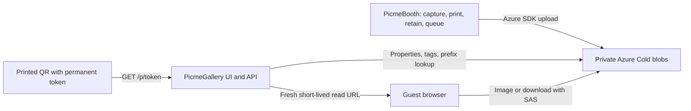

# Purpose and architecture

## Why PicmeGallery exists

A photobooth guest receives a printed final image containing a QR code. Scanning that print should open the finished image and the original photos actually used in it, including after a year or longer. Discarded retakes are not part of that delivery.

PicmeGallery provides this guest-facing page independently of the booth computer. The booth can capture, print, retain sessions, and upload directly to Azure even when the gallery is unavailable. The gallery can be redeployed or moved without changing printed links, provided the public hostname and storage contract remain compatible.

It is a new application because the owner wants to preserve the existing `Picme.am` code and behavior for possible future use.

## Component responsibilities



| Component | Owns |
| --- | --- |
| PicmeBooth | Capture and final rendering; selected originals; token generation and QR stamping; retained local session records; manual/automatic upload requests; durable queue, retries, and local upload administration. |
| Azure Blob Storage | Private final/original bytes and their identifying tags and metadata. |
| PicmeGallery | Guest page, token validation, discovery of that guest's assets, upload-completion status, and authorization of individual downloads. |
| Cloudflare Worker | Forwarding the public gallery hostname to the Azure Web App origin while preserving paths and queries. |

PicmeBooth calls Azure directly. There is no gallery registration API, album-creation request, or required gallery database. The booth's local queue/catalog is not a gallery database.

## Guest delivery flow

1. PicmeBooth generates a cryptographically random token for the session and retains it locally in protected form. It stamps the permanent guest URL into a blank delivery-QR element in the final template. Intentionally configured static QR URLs remain separate.
2. After the session is complete, the booth knows the single final JPEG/GIF and the exact selected originals. The current deferred-upload workflow can retain that completed session without uploading it. Auto-upload defaults off; administrators can request retained sessions manually. Enabling automatic uploads affects future completed sessions rather than backfilling older ones.
3. When uploading is requested, the booth uploads the immutable final first, followed by its selected originals. It sets Cold tier, the agreed tags, and metadata. Network transfer/retry state remains local to the booth.
4. A scan opens `/p/{accessToken}`. The browser requests `/api/guest/{accessToken}`.
5. The gallery validates the token, hashes it, and reads the deterministic final blob. It queries that hash's index tags and uses a matching prefix listing while Azure's tag index catches up. It validates every returned candidate.
6. The guest sees the final as soon as it is available, with an originals-uploading indication until all expected originals are discoverable. Retained sessions that have not been requested for upload show the waiting state.
7. Each preview/download goes through a scoped media endpoint. The server checks the asset and redirects to a new five-minute, HTTPS, read-only SAS for that individual blob.

## Permanent links and access control

The proposed printed URL is:

```text
https://photos.picme.am/p/{accessToken}
```

The token is 32 random bytes encoded as canonical, unpadded Base64URL: exactly 43 characters. It is not a sequential session ID, an Event ID, or an encrypted form of either. Possession of the link grants read access to that session; someone who shares the QR/link also shares that access.

To locate storage, compute:

```text
guestKeyHash = lowercase_hex(SHA256(UTF8(accessToken_text)))
```

Hash the 43-character text, not the decoded random bytes. The booth and gallery must agree on this detail. The raw token is not stored in blob paths or tags. There is no lookup table: the hash determines the session prefix, and tags/metadata identify its contents.

The guest token has no automatic expiry. The five-minute SAS is a separate, replaceable download credential; scanning the same printed QR later produces fresh authorized download URLs. Keeping a printed link usable still requires retaining the domain, service, blobs, tags, metadata, and working server credentials.

Malformed tokens return 404. Unknown well-formed tokens return a generic waiting state rather than another guest's content. Every media request validates the token and an allowed asset ID. There is no login, event-owner role, or token-revocation UI in this phase.

## Storage contract, version 1

### Layout and media

```text
sessions/{guestKeyHash}/final.jpg
    OR sessions/{guestKeyHash}/final.gif
sessions/{guestKeyHash}/originals/001.jpg
sessions/{guestKeyHash}/originals/002.png
```

One completed session has one final. JPEG and animated GIF finals use the same public asset ID, `final`; the gallery resolves the physical filename. Originals use three-digit indices and `.jpg`, `.jpeg`, or `.png` extensions. GIF is allowed for the final, not for an original. Existing bytes are served without resizing or transcoding.

All assets must be private and explicitly **Cold**. The gallery rejects a candidate with the wrong tier, MIME type, schema, identifying fields, or original index/count. An Event ID is a non-secret grouping label. Its rule is `^[a-z0-9][a-z0-9_-]{0,63}$`; `anna-david` is valid. The booth snapshots it for the capture. In the current deferred-session workflow, a blank booth event falls back to the local capture date, `yyyy-mm-dd`; the gallery receives the resulting valid label and does not create an event record.

### Index tags

Tag names and values are case-sensitive parts of the contract:

| Tag | Value |
| --- | --- |
| `EventId` | The captured event label. Multiple booths can use the same label for one event. |
| `GuestKeyHash` | The 64-character lowercase hash described above. |
| `Kind` | `Final` or `Original`. |

Event labels are not sufficient to authorize a guest. Do not replace the guest hash lookup with an unrestricted Event ID query.

### Metadata

| Lowercase key | Meaning |
| --- | --- |
| `schemaversion` | `1`. |
| `contentsha256` | Lowercase hexadecimal SHA-256 of the file's bytes. |
| `capturetimeutc` | Capture timestamp written by the booth; no guest expiry is derived from it. |
| `originalindex` | `0` for the final; `1` through the expected count for originals. |
| `expectedoriginalcount` | Total selected originals, currently 1–100. |

The gallery validates the checksum metadata's shape; it does not download and hash every image on every page request. The booth verifies bytes and reconciles successful/ambiguous uploads. Do not use this metadata as a substitute for storage access control.

The original index must match the filename. Originals must match the final's event and expected count. Discovery deduplicates by original index. If the final exists under an invalid contract, the guest can remain in waiting state; inspect blob properties/tags rather than assuming every waiting response means a transfer is still running.

## HTTP surface

| Route | Behavior |
| --- | --- |
| `GET /` | Landing page; asks the guest to scan a print. |
| `GET /p/{token}` | Gallery shell for a structurally valid token. |
| `GET /api/guest/{token}` | `waiting`, `uploading`, or `ready`, final/original descriptions, expected/uploaded counts, and same-origin preview/download paths. |
| `GET /api/media/{token}/{id}` | Validate ownership and asset contract, then redirect to a short-lived individual read SAS. `?download=true` requests attachment disposition. |
| `GET /health` | Process liveness. It does not test Azure configuration or storage access. |

The browser polls unfinished sessions with bounded retries, preserves already visible originals during index delays, and offers manual refresh. Server failures return a generic 503 response. The current frontend and backend share an origin; no separate frontend API origin is required.

## Decisions and their reasons

| Decision | Reason |
| --- | --- |
| Separate application and repository | Preserve the old `Picme.am` application and allow independent gallery deployment. |
| No database or album registry | Storage paths/tags supply the lookup; deploy/restart the gallery without migrating application state. |
| Direct Azure uploads from the booth | Capture/upload does not require a healthy gallery API. |
| Random permanent guest token | Printed QRs cannot be replaced when an expiring link stops working; random values also prevent easy enumeration. |
| Private storage with short-lived SAS | The permanent guest link authorizes access without making the entire container public. |
| Cold tier | Chosen for infrequently accessed retained photos with immediate online access. Archive is incompatible with an immediate guest page. |
| App Service F1 initially | One ASP.NET Core deployment can serve the UI and API with a low initial hosting cost. Its quotas and availability limits still apply. |
| Cloudflare subdomain proxy | Keep a stable public address while the Azure origin can change; avoid changing the legacy root/www application. |

Azure Functions was considered but was not selected for this implementation. This repository is an ASP.NET Core Web App, not a Functions package. A later Functions implementation must preserve the public/storage contracts and handle frontend hosting/routing explicitly.

## Current boundaries

Owner/admin event galleries and links, accounts/roles, resizing/thumbnails, cloud processing, media deletion, local cleanup policy, and automatic infrastructure provisioning are not implemented here. Do not imply that predictable Event IDs or a configured public hostname provide those features.

The gallery requires HTTPS Azure cloud storage. Emulator-only changes were reverted at the owner's request; there is no supported local HTTP storage mode. Running the web app locally against a real private Azure container is supported.

Implementation entry points: [Program.cs](../src/PicmeGallery.Web/Program.cs), [AzurePhotoStore.cs](../src/PicmeGallery.Web/AzurePhotoStore.cs), [GalleryContract.cs](../src/PicmeGallery.Web/GalleryContract.cs), and [gallery.js](../src/PicmeGallery.Web/wwwroot/gallery.js).
